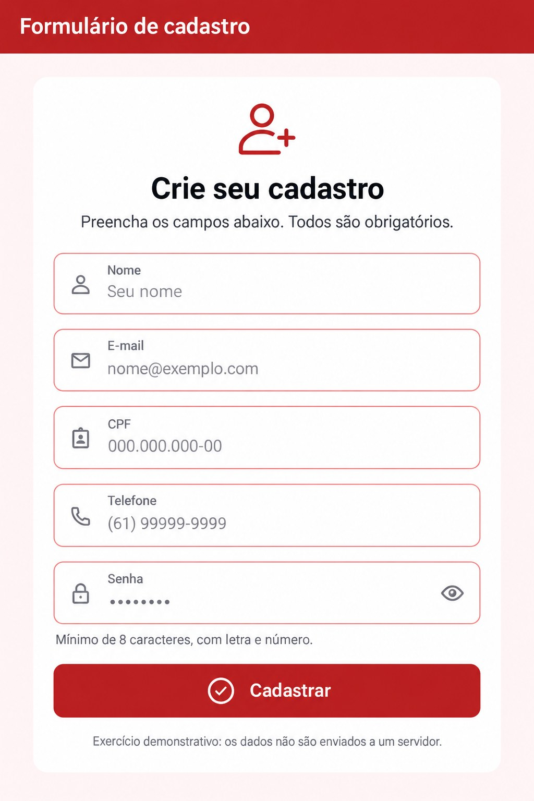

# Formulário de cadastro em Flutter

**Anny Gabrielly Gonçalves de Oliveira - 2310019**

Projeto acadêmico que aplica os fundamentos de formulários no Flutter: entrada de dados, tipos de teclado, máscaras, validação e feedback visual. A tela utiliza vermelho e branco e contém os campos **Nome, e-mail, CPF, telefone e senha**.

**Repositório:** https://github.com/annygabb/formularioflutter

## Prévia da tela



A imagem é uma **ilustração gerada a partir do layout do código**, não uma captura do aplicativo executado. A tipografia, os rótulos e os espaçamentos podem variar na execução. O projeto implementa uma tela de cadastro; não possui tela de login.

## Objetivo e escopo

Implementar um formulário completo usando `TextFormField` dentro de um `Form`, permitir entradas adequadas a cada campo, mostrar erros abaixo dos campos inválidos e apresentar um `SnackBar` após um envio válido.

O cadastro é demonstrativo e local: os dados não são enviados, não são gravados e não criam uma conta. Uma integração HTTP com backend é uma evolução futura.

## Executar no VS Code

Pré-requisitos: SDK Flutter com Dart 3.3 ou superior, extensão Flutter/Dart no VS Code e Chrome. Git é necessário para clonar. Referência de instalação: https://docs.flutter.dev/install/with-vs-code

```bash
git clone https://github.com/annygabb/formularioflutter.git
cd formularioflutter
flutter doctor
flutter pub get
flutter run -d chrome
```

A pasta `web` já está incluída. **Não é necessário executar `flutter create` para rodar no Chrome.** Abra a pasta que contém `pubspec.yaml` no VS Code. Também é possível selecionar Chrome como dispositivo e pressionar F5.

Enquanto o aplicativo estiver aberto, `r` recarrega, `R` reinicia e `q` encerra a execução no terminal.

### Android (opcional)

O pacote publicado está preparado para Web. Para gerar a estrutura Android, configure o Android SDK e execute `flutter create --project-name cadastro_flutter --platforms=android .`. Antes, faça uma cópia da pasta `lib`; confira que o seu `lib/main.dart` continua contendo `CadastroApp`. Se surgir o contador padrão, restaure os três arquivos de `lib` do repositório. Remova apenas o teste padrão `test/widget_test.dart` se ele for gerado; mantenha `test/cadastro_test.dart`.

## O que foi implementado

| Conceito da aula | Aplicação |
| --- | --- |
| `Form` | Agrupa os cinco campos em uma unidade de validação |
| `GlobalKey<FormState>` | Permite acessar o estado do formulário |
| `TextFormField` | Combina entrada e validação por campo |
| `InputDecoration` | Define rótulos, exemplos, ícones, bordas e ajuda |
| `TextEditingController` | Mantém o conteúdo digitado; liberado em `dispose()` |
| `keyboardType` | Sugere teclado de nome, e-mail, números, telefone ou senha |
| `inputFormatters` | Restringe/formata entradas e aplica máscaras |
| `validator` | Retorna uma mensagem de erro ou `null` para entrada válida |
| `validate()` | Confere todos os campos antes de confirmar o cadastro |
| `AutovalidateMode.onUserInteraction` | Atualiza as validações após a interação |
| `SnackBar` | Mostra a confirmação de cadastro local |

Outros cuidados: rolagem com teclado aberto, largura máxima de 520 pixels, botão para mostrar/ocultar senha, dicas de preenchimento automático e suporte à colagem/edição nas máscaras.

## Regras de validação

| Campo | Formatação | Regra |
| --- | --- | --- |
| Nome | Até 100 caracteres; sem quebra de linha | Obrigatório; mínimo 3 caracteres; letras, espaços, hífen e apóstrofo |
| E-mail | Sem espaços; até 254 caracteres | Obrigatório; formato básico de endereço com domínio |
| CPF | `000.000.000-00` | 11 dígitos; rejeita números repetidos; calcula os dois dígitos verificadores |
| Telefone | `(00) 0000-0000` ou `(00) 00000-0000` | DDD brasileiro válido; fixo de 10 dígitos com prefixo 2-5; celular de 11 dígitos com prefixo 9 |
| Senha | Oculta; botão de visibilidade | Mínimo 8 caracteres; pelo menos uma letra e um número; sem espaços |

As regras são escolhas didáticas, pois o enunciado não especificou os limites. Validar a estrutura de CPF, telefone ou e-mail não confirma titularidade, existência ou disponibilidade.

## Fluxo do cadastro

1. A pessoa preenche os campos.
2. As máscaras formatam CPF e telefone durante a edição.
3. Os validators mostram mensagens abaixo dos campos inválidos.
4. Ao clicar em Cadastrar ou concluir no teclado, `_cadastrar()` fecha o teclado e chama `validate()`.
5. Se existir erro, a confirmação não é exibida.
6. Com todos os campos válidos, o aplicativo mostra o SnackBar vermelho de sucesso local.

## Organização do código

```text
lib/main.dart                 App, tema, tela e fluxo de envio
lib/validators.dart           Regras de cada campo
lib/formatters.dart           Máscaras de CPF e telefone
test/cadastro_test.dart       Testes de regras, máscaras e envio
web/index.html                Entrada da versão Web
.vscode/launch.json           Configuração de execução pelo VS Code
docs/images/tela-cadastro.jpg Prévia ilustrativa da interface
docs/documentacao.pdf         Documentação acadêmica
```

## Testes e verificação

```bash
dart format lib test
flutter analyze
flutter test
flutter build web
```

Os testes incluídos cobrem CPF válido/inválido, sequência repetida, regras dos outros campos, colagem com máscara, exclusão de separador, envio vazio e cadastro válido com SnackBar.

**Status:** o ambiente de autoria não possui Flutter/Dart instalado; os testes e o build deste formulário não foram executados aqui. O log de execução fornecido durante a configuração mostrou o aplicativo padrão do Flutter aberto no Chrome, o que confirma a instalação local, mas não valida este formulário. Execute os comandos acima para validar a versão publicada.

### Roteiro manual

- Envie vazio e confira as mensagens de erro.
- Digite e-mail inválido, CPF repetido e senha curta.
- Corrija os dados e confira a atualização das mensagens.
- Cole CPF/telefone e apague caracteres, inclusive separadores.
- Teste mostrar/ocultar senha, rolagem e tamanhos menores de tela.
- Use dados fictícios: `Anny Oliveira`, `anny@exemplo.com`, `529.982.247-25`, `(61) 99999-1234`, `abc12345`.
- Envie e confira a confirmação local.

## Problemas comuns

- **Flutter não reconhecido:** instale o SDK, adicione `flutter/bin` ao PATH e reinicie VS Code/terminal.
- **Tela do contador:** a pasta executada contém o exemplo padrão. Confira os três arquivos de `lib` e rode o comando na pasta correta.
- **Avisos de Android SDK ou Visual Studio:** são específicos desses alvos; Chrome deve estar aprovado em `flutter doctor` para execução Web.
- **Pacotes com versões mais novas:** o aviso de atualização não equivale a falha se o comando terminou com `Got dependencies`.

## Evoluções possíveis

Integração HTTP, tratamento de falhas de rede e confirmação pelo servidor. Persistência e autenticação deverão ser projetadas nessa etapa; a senha atual não é armazenada.

## Referências

- Formulários: https://docs.flutter.dev/cookbook/forms/validation
- Controllers: https://docs.flutter.dev/cookbook/forms/retrieve-input
- Formatadores: https://api.flutter.dev/flutter/services/TextInputFormatter-class.html
- Instalação: https://docs.flutter.dev/install/with-vs-code
